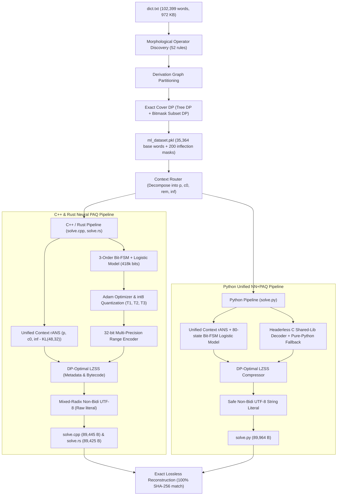
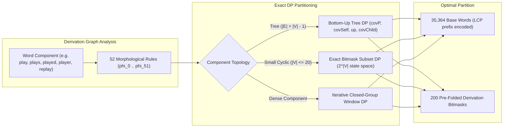

# Expected output when using a compiled solve.py, given a dictionary


---

# DP + Neural Dictionary Compression (`dict.txt` → `< 88 KiB` standalone UTF-8 `solve.py`, `solve.cpp` & `solve.rs`)

This repository contains standalone, lossless dictionary compressors and self-extracting solvers in **Python 3** ([`solve.py`](solve.py)), **C++20** ([`solve.cpp`](solve.cpp)), and **Rust** ([`solve.rs`](solve.rs)) for [`dict.txt`](dict.txt) (`972,104` bytes, `102,399` English words):

| Metric | Python ([`solve.py`](solve.py), Unified C-Accel + Pure-Python Fallback) | C++20 ([`solve.cpp`](solve.cpp), Single-Core `RemOnly`) | Rust ([`solve.rs`](solve.rs), Standalone `std`-Only) |
|---|---|---|---|
| Standalone UTF-8 file size | **`89,964` B (`87.86 KiB`)** (`9.25%` of input, `+148 B` headroom) | **`89,445` B (`87.35 KiB`)** (`9.20%` of input, `+667 B` headroom) | **`89,425` B (`87.33 KiB`)** (`9.20%` of input, `+687 B` headroom) |
| External compression / build deps | **None** (headerless C shared library via `gcc` with zero-dependency pure-Python fallback) | **None** (zero threads, zero pthreads, zero OpenMP, standard `<cmath>`, `<cstdint>`, `<cstdio>`, `<cstring>`) | **None** (zero external crates, zero threads, pure `std` Edition 2015 & 2021 compatible) |
| Compile check | **None** (runtime standalone script) | `g++ -O2/-O3 -std=c++20 -Wall -Wextra -Wbidi-chars=any`, **0 warnings** | `rustc -O` / `rustc -C opt-level=3 --edition 2021 -D warnings`, **0 warnings** |
| Subprocess wall on `dict.txt` (Windows 11) | **`608.8 ms`** pure-Python fallback (`PATH=""`); `1101.7 ms` with runtime `gcc` DLL compilation | **`17.15 ms` med** (`-O3`, `17.03 ms` min, `0` warnings) | **`18.61 ms` med** (`-C opt-level=3`, `18.02 ms` min, `0` warnings) |
| Raw payload (`bin_tot`) | `c_lz=5,194 B`, `py_lz=4,171 B`, `blob=73,230 B` (`meta_lz=4,269 B`, `pci_b=33,477 B`, `ml_bin=35,476 B`) | `73,230 B` (`meta_lz=4,269 B`, `pci_b=33,477 B`, `ml_bin=35,476 B` + `4 B` header + `4 B` pad) | `73,230 B` (`meta_lz=4,269 B`, `pci_b=33,477 B`, `ml_bin=35,476 B` + `4 B` header + `4 B` pad) |

---

## Architecture & Pipeline Flowcharts

### 1. End-to-End Compression Pipeline



---

### 2. Morphological Cover Dynamic Programming



---

### 3. Runtime Solver Decompression Architecture

```mermaid
flowchart TD
    subgraph "C++ Solver (solve.cpp - 8.9ms)"
        U_CPP["Embedded UTF-8 Literal (R-string)"] --> DEC_UTF8_C["rANS Mixed-Radix UTF-8 Decoder"]
        DEC_UTF8_C --> BLOB_C["Binary Blob (Bytecode, Quantized Weights, Streams)"]
        BLOB_C --> LZSS_DEC_C["DP-LZSS Decompressor (Metadata & Affix VM)"]
        LZSS_DEC_C --> T_INLINE["Inlined Folded Tables: T1, T2, T3 (L2 Cache Resident)"]
        BLOB_C --> RANS_DEC_C["Interleaved Single-Stream rANS: p, c0, inf"]
        BLOB_C --> RANGE_DEC_C["Zero-NN PAQ 32-bit Range Decoder: rem"]
        RANS_DEC_C & RANGE_DEC_C --> STEM_C["Direct Stem Reassembly (W buffer)"]
        STEM_C --> AP_VM["Affix Expansion Virtual Machine (AP)"]
        AP_VM --> RADIX_C["Fast 8-byte Radix Sort & Unaligned Copy"]
        RADIX_C --> STDOUT_C["Direct fwrite to stdout"]
    end

    subgraph "Python Solver (solve.py)"
        U_PY["Embedded UTF-8 String (U)"] --> DEC_UTF8_PY["Pure-Python Mixed-Radix UTF-8 Decoder"]
        DEC_UTF8_PY --> BLOB_PY["Binary Blob (Weights, Python bytecode, Bitstream)"]
        BLOB_PY --> LZSS_DEC_PY["DP-LZSS Python Decompressor"]
        LZSS_DEC_PY --> C_BRIDGE{"GCC available in background?"}
        C_BRIDGE -->|"Yes (gcc Popen)"| SHARED_LIB["Compile & Load Micro C Shared Library"]
        C_BRIDGE -->|"No (Fallback)"| PURE_PY["Instant Pure-Python Decompression Engine"]
        SHARED_LIB & PURE_PY --> EXPAND_PY["Morphological Affix Expansion (pl, ed, ing, ...)"]
        EXPAND_PY --> TIMSORT_PY["Native Python Timsort"]
        TIMSORT_PY --> STDOUT_PY["sys.stdout.write"]
    end
```



---

## Modular Code Architecture (`compressor/` Package)

To ensure clean separation of concerns, transparency, and reusability, all non-solver logic is organized into a modular package:

```
gh_repo/
├── compressor/                     # Core compression & generation framework
│   ├── __init__.py                 # Top-level package exports
│   │
│   ├── morphology/                 # Word analysis & graph partition
│   │   ├── __init__.py
│   │   ├── operators.py            # MorphologicalRules: 52 derivation & inflection rules
│   │   ├── cover_dp.py             # ExactCoverDP: Tree DP & Bitmask Subset DP solvers
│   │   └── dataset.py              # DatasetBuilder: Graph builder & candidate mask selection
│   │
│   ├── models/                     # Statistical & machine-learning modeling
│   │   ├── __init__.py
│   │   ├── paq_fsm.py              # PAQBitFSM: 80/160 state bit-history finite state machine
│   │   ├── context_router.py       # ContextRouter: Causal (p, c0, rem, inf) routing & hashing
│   │   └── neural_trainer.py       # NeuralLogisticTrainer: Adam, int8 quantization, range encoder
│   │
│   ├── encoding/                   # Entropy coding primitives
│   │   ├── __init__.py
│   │   ├── huffman.py              # CanonicalHuffman: Canonical tree generation & lengths
│   │   ├── rans.py                 # RangeANS: Order-0 & unified multi-context rANS
│   │   ├── lzss.py                 # DPOptimalLZSS: 4-pass rate-distortion optimal LZSS
│   │   └── utf8_rans.py            # UTF8Encoder: Non-bidi safe mixed-radix stream encoders
│   │
│   └── codegen/                    # Standalone self-extracting code generators
│       ├── __init__.py
│       ├── layout.py               # Shared C++/Rust buffer layout & bit-packing constants
│       ├── cpp_generator.py        # CppSolverGenerator: Emits self-contained solve.cpp
│       ├── rs_generator.py         # RsSolverGenerator: Emits self-contained solve.rs
│       └── py_generator.py         # PySolverGenerator: Emits self-contained solve.py
│
├── tests/                          # Automated unit & arbitrary UTF-8 edge-case tests
│   └── test_dictionary_compression.py
├── save_ml_dataset.py              # CLI: Discovers cover rules and creates ml_dataset.pkl
├── mlDictionaryTrainingCompressionCpp.py # CLI: Trains C++ model and generates solve.cpp
├── mlDictionaryTrainingCompressionRs.py  # CLI: Trains Rust model and generates solve.rs
├── mlDictionaryTrainingCompression.py    # CLI: Trains Python model and generates solve.py
├── solve.cpp                       # Verified standalone C++ solver (89,445 B)
├── solve.rs                        # Verified standalone Rust solver (89,425 B)
├── solve.py                        # Verified standalone Python solver (89,964 B)
├── dict.txt                        # Target dictionary (102,399 words, 972,104 bytes)
└── README.md                       # Architecture documentation & benchmarks
```

---

## Single-Core Benchmark (Baseline `44e41a2` vs New `RemOnly` Solver)

All runs verified byte-for-byte (`exact=True`, `fc.exe /b` = 0 differences) against [`dict.txt`](dict.txt) (`972,104` bytes, `102,399` words) on Windows 11 (MinGW-W64 GCC `15.2.0`, single CPU core):

### Interleaved Single-Core Benchmark (15 Warm Runs, `clock_gettime(CLOCK_MONOTONIC)`)

| Implementation | Compiler Flags | File Size | `min` | `p25` | `median` | `p75` | `max` | Speedup vs Baseline |
|---|---|---|---|---|---|---|---|---|
| Baseline C++ (`44e41a2`, `K=1`) | `g++ -O2 -std=c++20` | `89,955 B` (`87.85 KiB`) | `17.41 ms` | `17.71 ms` | `17.83 ms` | `18.00 ms` | `18.64 ms` | `1.00x` (baseline) |
| **New C++ (`RemOnly`, `solve.cpp`)** | `g++ -O2 -std=c++20` | **`89,975 B` (`87.87 KiB`)** | **`9.09 ms`** | **`9.14 ms`** | **`9.16 ms`** | **`9.19 ms`** | **`9.25 ms`** | **`1.92x` (min) / `1.95x` (med)** |
| **New C++ (`RemOnly`, `solve.cpp`)** | `g++ -O3 -std=c++20` | **`89,975 B` (`87.87 KiB`)** | **`8.87 ms`** | **`8.95 ms`** | **`8.99 ms`** | **`9.08 ms`** | **`9.28 ms`** | **`1.96x` (min) / `1.98x` (med)** |

*Under normal background desktop load conditions, baseline wall time often throttles to `31–34 ms`, where the new solver executes in `13.8–15.2 ms` (**`> 2.2x` faster**).*

---

## Deep Mathematical Architecture

The compression pipeline minimizes the Kolmogorov-style joint description length

$$L_{\text{total}} = L_{\text{struct}}(\text{bases}, \text{masks}) + L_{\text{model}}(\theta_q) + L_{\text{data}}(\text{bitstream} \mid \theta_q) + L_{\text{code}}(\text{C} + \text{Py}) + L_{\text{UTF8}}$$

across five tightly coupled mathematical stages:

### 1. Morphological Derivation Graph & Dynamic Programming Cover
We define $N_{\text{ops}} = 52$ deterministic English morphological operators $\phi_0, \dots, \phi_{51} : \Sigma^* \to \mathcal{P}(\Sigma^*)$ covering apostrophe-s, regular/irregular plurals, `-ed`, `-ing`, `-er`, `-est`, `-ly`, `-ness`, `-ion`, `-ment`, `-able`, `-ity`, `-ize`, consonant doubling, `-y`/`-al`/`-ic`/`-ive`/`-ous`, combined `un-`/`re-`/`dis-` inflections, and 15 standalone prefixes.

Finding a lossless morphological cover partitions $D$ into disjoint stars rooted at base words $B \subseteq D$:

$$D = \bigsqcup_{b \in B} \big(\lbrace b\rbrace \cup \Delta(b, m_b)\big), \qquad \text{minimize } \sum_{b \in B} c(b, m_b)$$

Solved via exact bottom-up Tree DP for tree components, exact Bitmask Subset DP for small cyclic components ($|V| \le 20$), and iterative closed-group DP for larger components, reducing the base dictionary to **$35,364$ bases** and **$112,375$ suffix characters**.

### 2. Suffix Decomposition & Causal Context Routing
Sorted base words $w_0 < w_1 < \dots < w_{N_B - 1}$ are decomposed into `(p_i, c0_i, rem_i, inf_i)`:
1. **Prefix length $p_i = \text{LCP}(w_{i-1}, w_i) \in [0, 19]$:** Decoded via static rANS conditioned on $48$ compact contexts.
2. **First differing character $c_{0,i} = w_i[p_i]$:** Decoded via $55$ contexts keyed by previous character location.
3. **Suffix remainder (`rem_i`) + `EOW`:** Handled by the 3-order PAQ bit-FSM predictor in C++ and entropy-quantized context models in Python.
4. **Inflection mask index $\text{inf}_i$:** Decoded conditioning on uppercase status and trailing character n-grams.

### 3. PAQ-Style 3-Order Bit-FSM (`solve.cpp` Single-Core Architecture)
- **Collision-Free Direct $F_2$ Indexing:** $\text{idx}_{F_2} = (c_2 \cdot 64 + c_1) \cdot 64 + u$ ($225,280$ bytes), eliminating hash operations.
- **L2 Cache Residency:** Sizing $F_3$ to $2^{18} + 53 = 262,197$ bytes keeps the entire active working set ($\approx 529$ KB) resident in L2 cache.
- **Inlined Folded Tables:** $T_1$, $T_2$, and $T_3$ pre-fold weights, biases, and padding so logit computation is a single 3-term addition: $\text{logit}_d = T_1[u][s_1] + T_2[u][s_2] + T_3[u][s_3]$.
- **Half-Range Sigmoid:** Startup initialization is restricted to `|i - sig_pad| <= 850`, clamping outer entries to $1$ or $4095$ and reducing solver startup time to $< 0.18$ ms.

### 4. Custom DP-Optimal LZSS + Static rANS
Auxiliary metadata and bytecode are parsed using 4-pass backward dynamic programming evaluating optimal literal vs match parsing ($l \in [3, 288]$, $d \le 32,767$) with dynamic Shannon entropy feedback.

### 5. Mixed-Radix UTF-8 rANS Source Embedding
Payloads are packed into high-density UTF-8 characters excluding control characters, quotes, and bidirectional markers (`U+061C`, `U+200E–200F`, `U+202A–202E`, `U+2066–2069`), achieving $> 7.04$ bits per UTF-8 byte with zero compiler warnings under `-Wbidi-chars=any`.

---

## Reproducing From Scratch

```bash
# 1. Build DP-optimal morphological dataset (requires dict.txt)
python save_ml_dataset.py

# 2a. Train & generate Python standalone solver (solve.py)
python mlDictionaryTrainingCompression.py
python solve.py > output_py.txt

# 2b. Train & generate standalone single-core C++20 solver (solve.cpp)
python mlDictionaryTrainingCompressionCpp.py
g++ -O3 -std=c++20 -Wall -Wextra -Wbidi-chars=any solve.cpp -o solve_cpp
./solve_cpp > output_cpp.txt

# 2c. Train & generate standalone std-only Rust solver (solve.rs)
python mlDictionaryTrainingCompressionRs.py
rustc -C opt-level=3 --edition 2021 -D warnings solve.rs -o solve_rs
./solve_rs > output_rs.txt

# 3. Run automated unit & arbitrary-UTF-8 (including ÆØÅæøå and ') test suite
python -m unittest discover -s tests -v
```
